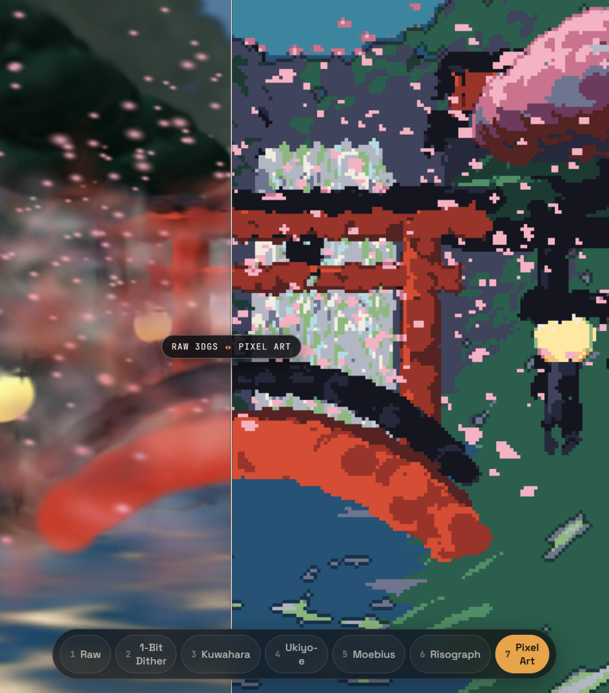

# Splat Shader Demo

Real-time WebGL2 3D Gaussian Splatting with screen-space NPR shaders, `.ply` / `.glb` model import, split-screen compare, and 3D spatial Web Audio.

<p align="center">
  
</p>

## Quick Start

```bash
npm install
npm run dev
```

Open `http://localhost:5173/`.

## Features

* **7 Live Modes (`1`–`7`):**
  1. **Raw Splat** — soft EWA-projected 3D Gaussian splats
  2. **Obra Dinn 1-Bit** — strict 2-color Bayer dither with view-ray stabilization + depth silhouettes
  3. **Kuwahara Oil** — oriented 4-quadrant painterly filter (`2 / 4 / 6 px` brush radius)
  4. **Ukiyo-e Woodblock** — sumi depth keylines, bokashi sky wash, 5-tone stepping, washi grain
  5. **Ligne Claire / Moebius** — flat cel pastel bands, shadow hatching, crisp technical-pen contours
  6. **Risograph Zine** — 3-ink spot overprint (pink, teal, indigo) with rotated halftone screens
  7. **Pixel Art** — 2×-supersampled hard-disc surfels, majority-vote palette snapping (5 retro palettes), self-tinted 1-px outlines, and optional Bayer dither
* **Import `.PLY` / `.GLB` / `.GLTF`:** Click **Import .PLY / .GLB** or drag & drop onto the canvas. Supports 3DGS `.ply` splats, colored `.ply` point clouds, point-cloud `.glb` files, and textured triangle-mesh `.glb` models (sampled into surface-aligned surfels).
* **3 Built-In Sample Worlds:** Moebius Ruin, Ukiyo-e Shrine, and Storm Lighthouse, each with 3 positional HRTF Web Audio emitters and distance/rear low-pass occlusion.
* **Clean Presentation Mode (`H` or `Hide UI`):** Hides surrounding chrome down to a compact `1`–`7` style bar that expands into the full controls on hover.

## Controls

* **Drag:** Orbit · **Scroll:** Zoom · **`WASD` / Arrows:** Walk · **`R`:** Reset camera
* **`1`–`7`:** Switch shader · **`Space`:** Toggle split-screen compare · **`H`:** Toggle Hide UI

## Architecture

* `src/splats/SplatCloud.js` — WebGL2 EWA 3DGS renderer (float `DataTexture` storage, 16-bit CPU radix sort, dual-pass color + core depth, plus hard-disc surfel pass for Pixel Art)
* `src/shaders/nprPostProcess.js` — GLSL post-processing suite & split-screen compare
* `src/splats/loaders.js` — `.ply` (3DGS & point-cloud) and `.glb`/`.gltf` (point-cloud & mesh-to-surfel) importers
* `src/splats/sampleWorlds.js` — 3 procedural Gaussian splat worlds
* `src/audio/spatialAudio.js` — HRTF `PannerNode` spatial audio + procedural synths
